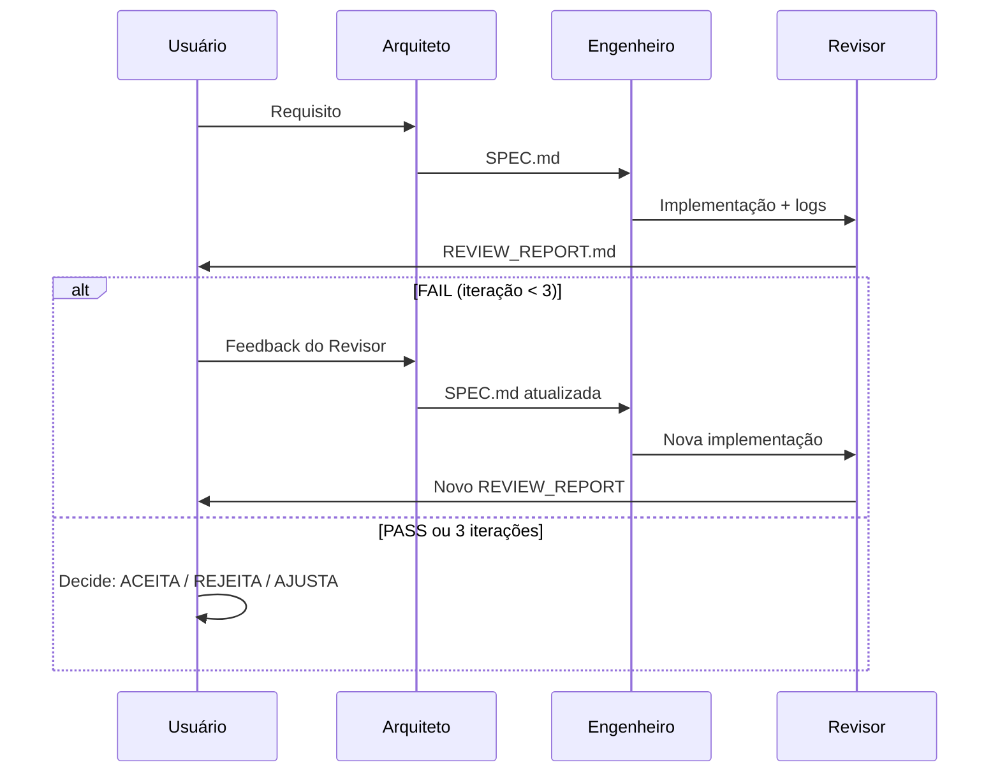

# Agents Configuration — cli-vox

## Visão Geral

Três agentes especializados operam em loop controlado (máx. 3 iterações) para entregar tarefas com qualidade garantida.

```
┌─────────────┐     specs      ┌─────────────┐     code      ┌─────────────┐
│  ARQUITETO  │ ─────────────► │  ENGENHEIRO │ ─────────────► │  REVISOR    │
└─────────────┘                └─────────────┘                └─────────────┘
      ▲                                                                        │
      │                                                                        ▼
      │                                                         ┌───────────────────────┐
      └───────────────── (feedback/issues, máx 3x) ──────────── │  DECISÃO DO USUÁRIO   │
                                                                 └───────────────────────┘
```

---

## 1. ARQUITETO (`architect`)

**Responsabilidade:** Produzir especificação técnica completa e acionável.

### Entrada
- Requisito do usuário (feature, bug, refactor, etc.)
- Contexto do código atual (arquivos relevantes, stack, convenções)

### Saída — `SPEC.md` (Markdown estruturado)
```markdown
# Spec: <titulo>

## Contexto
- Problema/objetivo
- Arquivos afetados (paths)
- Dependências/constraints

## Requisitos Funcionais
- [ ] RF1: ...
- [ ] RF2: ...

## Requisitos Não-Funcionais
- Performance: ...
- Segurança: ...
- Compatibilidade: ...

## Contratos/Interfaces
- TypeScript interfaces, types, signatures
- CLI args, env vars, config schema

## Plano de Implementação (passos ordenados)
1. ...
2. ...

## Critérios de Aceite (checklist para o Revisor)
- [ ] Critério 1
- [ ] Critério 2
```

### Regras
- **Não escreve código de implementação** — apenas interfaces, types, assinaturas, pseudocódigo se necessário.
- Especifica **arquivos exatos** a criar/modificar.
- Define **critérios de aceite objetivos** (testáveis pelo Revisor).
- Se requisito for vago → devolve perguntas clarificadoras ao usuário (não assume).

---

## 2. ENGENHEIRO (`engineer`)

**Responsabilidade:** Implementar **exatamente** o que a SPEC determina.

### Entrada
- `SPEC.md` gerado pelo Arquiteto
- Acesso ao codebase (read/edit)

### Saída
- Código implementado nos arquivos especificados
- Testes se a SPEC exigir
- `IMPLEMENTATION_LOG.md` (resumo do que foi feito, desvios se houver)

### Regras
- **Segue a SPEC à risca** — não inventa, não melhora, não refatora fora do escopo.
- Se encontrar ambiguidade na SPEC → **para e pergunta ao Arquiteto** (não assume).
- Commits atômicos por passo do plano.
- Roda `lint`, `typecheck`, `test` localmente antes de passar pro Revisor.

---

## 3. REVISOR (`reviewer`)

**Responsabilidade:** Verificar se a implementação cumpre **todos** os critérios da SPEC.

### Entrada
- `SPEC.md` (critérios de aceite)
- Diff da implementação (arquivos alterados)
- Output de `lint`, `typecheck`, `test`, `build`

### Saída — `REVIEW_REPORT.md`
```markdown
# Review Report — <spec-title>

## Status: PASS | FAIL | PARTIAL

## Checklist dos Critérios de Aceite
- [x] Critério 1 — OK
- [ ] Critério 2 — FALHOU: <evidência>
- [ ] Critério 3 — N/A (não aplicável)

## Qualidade de Código
- Lint: PASS/FAIL (detalhes)
- TypeCheck: PASS/FAIL
- Testes: PASS/FAIL (cobertura)
- Build: PASS/FAIL

## Segurança/Performance
- [ ] Sem secrets hardcoded
- [ ] Sem SQL injection / command injection
- [ ] Complexidade aceitável

## Observações / Bloqueadores
- ...
```

### Regras
- **Binário por critério**: PASS ou FAIL (não "quase").
- Se **qualquer** critério de aceite falhar → `FAIL` geral.
- Se build/lint/test falhar → `FAIL` geral.
- `PARTIAL` só se critérios subjetivos (ex: "código limpo") falharem mas funcionais passarem.
- **Não sugere fixes** — apenas aponta o que falhou e onde.

---

## Loop de Execução (Orquestração)



### Controle de Iteração
- Variável `ITERATION` (1..3) passada entre agentes.
- Em `ITERATION=3` com `FAIL` → **para e escala pro usuário** (não loop infinito).
- Usuário decide: aceitar como está, ajustar requisito, ou abortar.

---

## Como Invocar (Exemplo)

```bash
# 1. Usuário dispara o ciclo
/architect "Criar comando 'deploy' que roda scripts de build e push via SSH"

# 2. Arquiteto gera SPEC.md → salva em .agents/spec-<timestamp>.md

# 3. Engenheiro lê SPEC, implementa, roda checks
/engineer .agents/spec-<timestamp>.md

# 4. Revisor avalia
/reviewer .agents/spec-<timestamp>.md

# 5. Se FAIL e iter < 3 → volta pro Arquiteto com feedback do Revisor
#    Se PASS ou iter=3 → usuário decide
```

---

## Diretórios de Trabalho

```
.agents/
├── spec-<timestamp>.md          # SPEC do Arquiteto
├── implementation-<timestamp>.md # Log do Engenheiro
└── review-<timestamp>.md        # Relatório do Revisor
```

---

## Princípios Gerais

1. **Single Source of Truth**: A SPEC é o contrato. Ninguém desvia.
2. **Fail Fast**: Revisor é rigoroso. Engenheiro não "esconde" problemas.
3. **Transparência**: Todos artefatos são arquivos legíveis (Markdown).
4. **Controle Humano**: Usuário tem veto final após 3 iterações.
5. **Rastreabilidade**: Cada ciclo gera artifacts versionáveis.